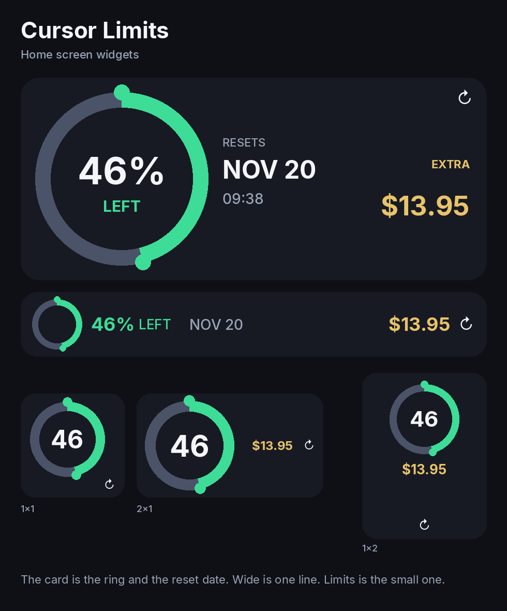

# Cursor Limits

Project page, with the APK download: [w1neskin.github.io/cursor-limits](https://w1neskin.github.io/cursor-limits/)

Android home-screen widgets for a Cursor subscription. The card shows the plan name, how much of the weekly limit is left, when it resets, and the extra credits in dollars.

The app is built for a phone, including a Samsung Galaxy in a five-column grid. It runs on Android 8 and newer.

The pictures below are interface previews with sample numbers (`46%` left, `$13.95`). A signed-in phone shows the account’s own figures.




## What the numbers mean

| Line | Meaning |
| --- | --- |
| Plan | The Cursor plan name, for example Super. |
| Percent left | Share of the current weekly limit that is still unused. |
| Used | Share already spent, to one decimal place. |
| Reset | Local date and time when the weekly cycle ends. |
| Extra credits | Extra credits in dollars, separate from the weekly limit. |

Green is the remaining weekly percent. Gold is the extra-credit balance. The blue bar is how much of the week is already used.

## Widgets

Long-press the home screen, open Widgets, and pick one of three:

### Limits Card

The full card: plan, percent left, blue bar, reset time, and extra credits. Drag it wider to fill the row. On a five-column screen that is 5 cells wide and 2 cells tall.

### Limits Wide

One row: percent left, extra credits, and the usage bar underneath. It stretches across the screen the same way the card does.

### Limits

One small widget that you resize by dragging an edge.

| Size | What it shows |
| --- | --- |
| 1×1 | The remaining percent only. Tap it to open the app. |
| 2×1 | Remaining percent and extra credits, side by side, plus refresh. |
| 1×2 | The same two numbers stacked, plus refresh. |
| 2×2 | The same two numbers, larger, if you drag both the width and the height. |

Green is the percent left. Gold is the extra credits. The 1×1 size shows only the green number.

The refresh mark updates immediately. On the 1×1 size there is no room for it, so a tap opens the app instead.

## The app

Version 2.1 is one screen, split down the middle. The home-screen card shows a ring for the weekly remainder, the reset date beside that ring, and extra credits on the right.

The left half is mint. It shows the weekly limit that is left, and under that the day and time the week resets. That date belongs only to the weekly limit.

The right half shows extra credits in dollars. It does not reset on that day. A moon in the top corner means dark. A sun means light. Tap it to switch. The same choice restyles every widget already on the home screen.

Each half has an alert at the bottom. Tap the number and minus appears on the left, plus on the right. The digits stay where they were. One tap moves by 1% or by $1. Holding the button speeds up, then jumps by 5 and by 10. The percent runs from 1 to 100. The dollar alert runs from $1 up to the extra credits on screen, so a balance of $13.94 cannot be set past $13.94. The first change turns that alert on. Android 13 and newer asks for notification permission then. The alert fires once when the number falls to the line you set, and it can fire again after the number climbs back above it.

Before you sign in, the halves show an example and the bottom left says Sign in. Tap that, or tap the big percent. Sign in with Google, GitHub, or email. After that, the bottom left opens two wheels: hours and minutes scroll separately. Minutes step by 15. Hours are not capped at 6. The wheels start at 00:00, which means there is no timer and a tap on the percent refreshes. Sign out is on that same sheet. Battery opens the system page for this app. If updates stall overnight, set battery to Unrestricted.

Android will not run a periodic widget update faster than every 15 minutes. A Samsung phone can wait longer while the screen is off. Tapping the percent does not wait for that schedule.

## Install

The current debug build is [`dist/cursor-limit.apk`](dist/cursor-limit.apk). Copy it to the phone and open it. Android will ask you to allow installation from that source. Installing a newer build over the existing app keeps the session and the widgets already on the home screen, as long as the new file is signed with the same key.

The signing key is not in this repository. A build you produce yourself gets a new key unless you point Gradle at the keystore that signed the installed app. A different key means uninstalling first, which drops the session and the placed widgets.

## Build

You need JDK 17 and Android SDK 35.

```bash
export ANDROID_HOME="$HOME/android-sdk"
echo "sdk.dir=$ANDROID_HOME" > local.properties
./gradlew :core:test :app:assembleDebug
```

The APK is written to `app/build/outputs/apk/debug/app-debug.apk`.

To sign with your own key, add these lines to `local.properties` (that file is not committed) and put `app/release.keystore` next to the app module. Both the debug and release builds then use that key, so an update can replace the installed app.

```properties
CURSOR_LIMIT_STORE_PASSWORD=your-store-password
CURSOR_LIMIT_KEY_PASSWORD=your-key-password
CURSOR_LIMIT_KEY_ALIAS=your-alias
```

The same values can be passed as environment variables of those names.

Create a keystore with:

```bash
keytool -genkeypair -v \
  -keystore app/release.keystore \
  -alias cursorlimit \
  -keyalg RSA -keysize 2048 -validity 10000
```

## Project layout

| Path | Role |
| --- | --- |
| `app/` | Android app, widgets, sign-in, refresh schedule, alerts. |
| `core/` | Parsing and the text shown on the card. No Android dependencies. |
| `core/src/test/` | Unit tests for the period, the credit balance, and the card copy. |
| `dist/cursor-limit.apk` | Latest signed debug build for sideloading. |

## Privacy

The login stays on the phone. It is not inside the APK and it is not in this repository. The widgets show the last saved numbers.
