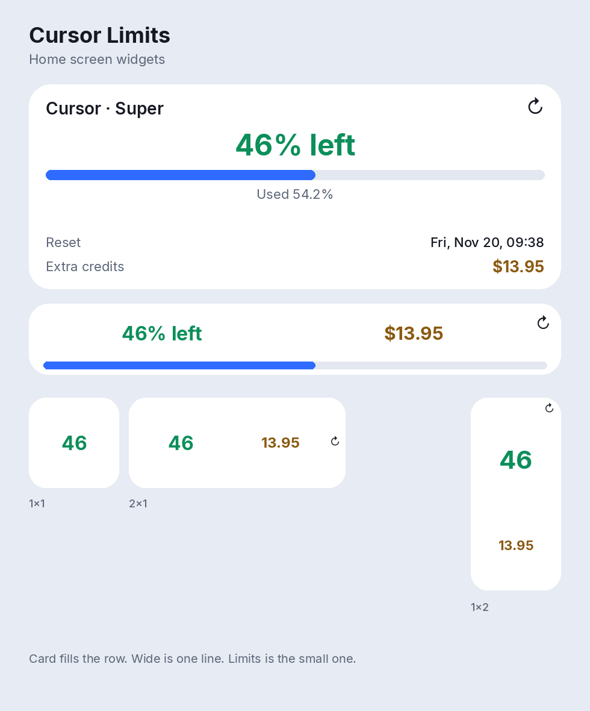
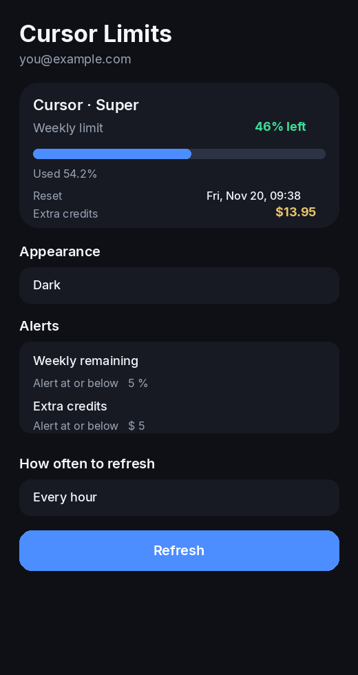

# Cursor Limits

Android home-screen widgets for a Cursor subscription. The card shows the plan name, how much of the weekly limit is left, when it resets, and the extra-credit balance in dollars. The phone loads those numbers itself after you sign in. Nothing is typed in by hand.

The app is built for a phone, including a Samsung Galaxy in a five-column grid. It runs on Android 8 and newer.

The pictures below are interface previews with sample numbers (`46%` left, `$13.95`). A signed-in phone shows the account’s own figures.




## What the numbers mean

| Line | Meaning |
| --- | --- |
| Plan | The Cursor plan name, for example Super. |
| Percent left | Share of the current weekly limit that is still unused. |
| Used | Share already spent, to one decimal place. |
| Reset | Local date and time when the weekly cycle ends. |
| Extra credits | Prepaid balance in dollars, separate from the included weekly limit. |

Green is the remaining weekly percent. Gold is the extra-credit balance. The blue bar is how much of the week is already used.

## Widgets

Long-press the home screen, open Widgets, and pick one of three:

### Limits Card

The full card: plan, percent left, usage bar, reset time, and extra credits. It starts wide enough for about five columns and can be dragged narrower, down to four. As it grows, the type grows with it. The percent and the “used” line stay centered, and the reset time and credit balance sit on opposite edges, so a wider card does not leave the text stuck to the left.

### Limits Wide

One row: percent left, extra credits, and the usage bar underneath. It stretches across the screen the same way the card does.

### Limits

One small widget that you resize by dragging an edge.

| Size | What it shows |
| --- | --- |
| 1×1 | The remaining percent only. Tap it to open the app. |
| 2×1 | Remaining percent and extra credits, side by side, plus refresh. |
| 1×2 | The same two numbers stacked, plus refresh. |
| 2×2 | The same two numbers, larger. A launcher that lets you drag both width and height will offer this size as well. |

On this widget the percent sign and the dollar sign are left off, because a one-cell column cannot hold `46%` and `$13.95` without breaking the line. The color still says which number is which, and the typeface is the same condensed face in every small size.

The refresh mark updates immediately. On the 1×1 size there is no room for it, so a tap opens the app instead.

## The app



Sign in with the button. A page from Cursor opens inside the app (Google, GitHub, or email, whichever the account uses). When sign-in finishes, the session stays on the phone in encrypted storage. Signing out of the app clears it. Signing out of Cursor in a browser ends it too.

There is no key to copy and no number to type. The sample card before sign-in is labeled as an example.

**Appearance** is Dark or Light. The choice restyles the settings screen and every widget already on the home screen.

**Alerts** are off until you turn them on. Each one fires once when a value falls to the number you set, and it can fire again after the value climbs back above that number.

- Weekly remaining: for example, at or below 5%.
- Extra credits: for example, at or below $5.

Android 13 and newer asks for notification permission the first time an alert is switched on.

**How often to refresh** is Button only, 15 minutes, 30 minutes, 1 hour, 3 hours, or 6 hours. Android will not run a periodic widget update faster than every 15 minutes. A Samsung phone can wait longer while the screen is off. The refresh button does not wait for that schedule. If updates stall overnight, set the app’s battery mode to Unrestricted.

## Install

The current debug build is [`dist/cursor-limit.apk`](dist/cursor-limit.apk). Copy it to the phone and open it. Android will ask you to allow installation from that source. Installing a newer build over the existing app keeps the session and the widgets already on the home screen, as long as the new file is signed with the same key.

The signing key is not in this repository. A build you produce yourself gets a new key unless you point Gradle at the keystore that signed the installed app. A different key means uninstalling first, which drops the session and the placed widgets.

## Build

You need JDK 17 and Android SDK 35.

```bash
export ANDROID_HOME="$HOME/android-sdk"
echo "sdk.dir=$ANDROID_HOME" > local.properties
./gradlew :core:test :app:assembleDebug
```

The APK is written to `app/build/outputs/apk/debug/app-debug.apk`.

To sign with your own key, add these lines to `local.properties` (that file is not committed) and put `app/release.keystore` next to the app module. Both the debug and release builds then use that key, so an update can replace the installed app.

```properties
CURSOR_LIMIT_STORE_PASSWORD=your-store-password
CURSOR_LIMIT_KEY_PASSWORD=your-key-password
CURSOR_LIMIT_KEY_ALIAS=your-alias
```

The same values can be passed as environment variables of those names.

Create a keystore with:

```bash
keytool -genkeypair -v \
  -keystore app/release.keystore \
  -alias cursorlimit \
  -keyalg RSA -keysize 2048 -validity 10000
```

## Where the numbers come from

After sign-in, the app calls the same dashboard endpoints the Cursor website uses, with the session from that sign-in. This is not a documented public API. If Cursor changes a response, the card shows an error instead of an invented number, and the parser has to be updated.

The weekly percent comes from the current billing period. The dollar line prefers a positive prepaid balance, then a spending-page grant, then other credit fields the dashboard returns. It does not add those sources together.

Sign-in itself opens Cursor’s own login host. In a region Cursor does not serve, that page can fail until the phone uses a network Cursor accepts.

## Project layout

| Path | Role |
| --- | --- |
| `app/` | Android app, widgets, sign-in, refresh schedule, alerts. |
| `core/` | Parsing and the text shown on the card. No Android dependencies. |
| `core/src/test/` | Unit tests for the period, the credit balance, and the card copy. |
| `dist/cursor-limit.apk` | Latest signed debug build for sideloading. |

`download/` is an old note that the numbers are not entered by hand. The installed app is the product.

## Privacy

The session token never leaves the phone except as the `Authorization` header and cookie on requests to Cursor. It is not written into the APK and it is not part of this repository. Widgets read the last saved card from local storage. They do not contain the token.
